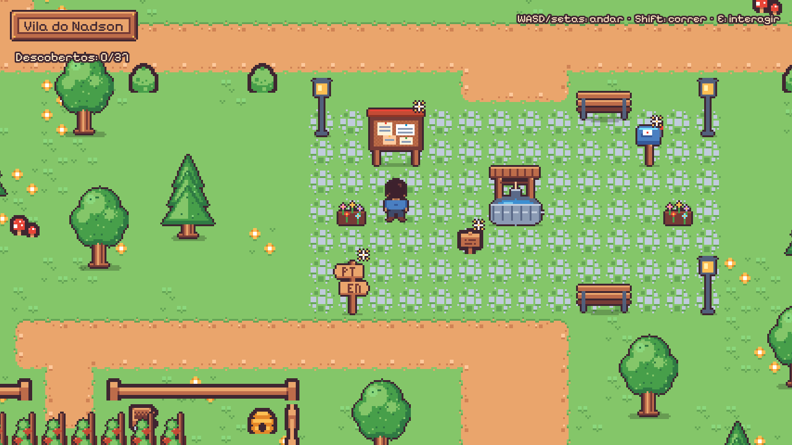
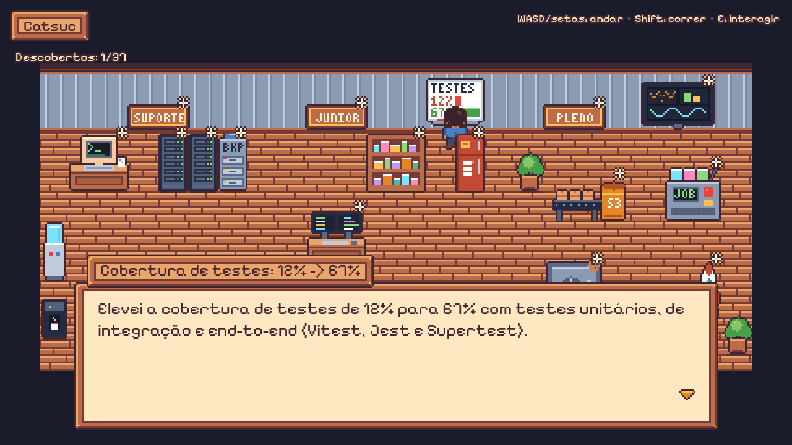

# Currículo Interativo — Nadson Alex

Jogo top-down em pixel art, no estilo Stardew Valley, que funciona como
currículo: você anda por uma vila e descobre a carreira do Nadson.

- **Escritório Catsuc** (NO): três zonas contando a progressão Suporte → Júnior → Pleno
- **Clínica NeuroKids** (NE): API NestJS, frontend, RBAC, auditoria e o pipeline de RAG
- **Escola UNIFAVIP** (SE): graduação, PROUNI, ênfases e certificação Rocketseat
- **Horta da stack** (SO): cada canteiro é uma categoria, cada planta uma tecnologia
- **Praça** (centro): boas-vindas, resumo, contato (com links) e idiomas





Feito com **Phaser 3 + TypeScript + Vite**.

## Como rodar

```bash
npm install
npm run dev        # http://localhost:5173
```

| Comando             | O que faz                                             |
| ------------------- | ----------------------------------------------------- |
| `npm run dev`       | servidor de desenvolvimento                           |
| `npm run build`     | typecheck + build estático em `dist/`                 |
| `npm run preview`   | serve o `dist/` localmente                            |
| `npm run sprites`   | regenera toda a pixel art (veja "Sprites" abaixo)     |
| `npm run typecheck` | só o typecheck                                        |

Abra com `?debug` na URL para ver os colisores.

## Controles

- **WASD** ou **setas**: andar · **Shift**: correr
- **E**, **Espaço** ou **Enter**: interagir / avançar o diálogo
- **Esc**: fechar o diálogo · **1–4**: abrir os links do contato

As estrelinhas marcam o que ainda não foi visto. O progresso
("Descobertos X/Y") fica salvo no navegador.

## Estrutura

```
index.html
public/assets/
  tilesets/world.png          tileset combinado (gerado): Kenney + tiles próprios
  tilesets/kenney-tiny-town/  pack original do Kenney (CC0)
  sprites/*.png               pixel art própria (gerada — não editar à mão)
  fonts/                      Pixelify Sans (OFL)
scripts/
  generate-sprites.ts         `npm run sprites`
  sprites/                    desenho de cada sprite em código
    draw.ts                   primitivas: retângulo, elipse, matriz ASCII, fonte 3x5, contorno
    palette.ts                paleta (extraída do Kenney para combinar)
    player.ts  nature.ts  buildings.ts  objects.ts  crops.ts  furniture.ts  tiles.ts  ui.ts
src/
  main.ts                     cria o Phaser.Game
  config.ts                   resolução, zoom, velocidade, alcance de interação
  types.ts                    MapDef, PropDef, Content...
  assets/sprites.gen.ts       manifesto dos sprites (gerado)
  data/                       TODO o texto do currículo
    profile.ts  catsuc.ts  neurokids.ts  education.ts  stack.ts
  maps/
    tileset.ts                índices dos tiles (Kenney + próprios)
    terrain.ts                grade de terreno + autotile (caminho, água, cerca, parede)
    village.ts                mapa da vila
    interiors.ts              os três interiores
  scenes/
    BootScene.ts              carrega assets e animações
    TitleScene.ts             tela inicial com a vila ao fundo
    WorldScene.ts             base das cenas exploráveis (jogador, câmera, interação, portas)
    VillageScene.ts  InteriorScene.ts
    UIScene.ts                HUD, prompt [E], diálogo e título (sem zoom, por cima)
  entities/Player.ts
  systems/                    map-render, interaction, progress, transition
  ui/                         DialogBox, Prompt, helpers de texto e moldura
docs/                         screenshots e prévia do tileset com índices
```

## Como editar

**Textos do currículo:** só em `src/data/`. Cada objeto do mapa aponta para
um `Content` (`title` + `pages`); cada página é um balão.

**Mapa:** `src/maps/village.ts` descreve o terreno com retângulos
(`grid.rect("path", x, y, w, h)`) e coloca objetos com `place(...)`. Posições em
tiles, no centro-inferior do sprite. Caminhos e água precisam ter pelo menos
2 tiles de largura para o autotile funcionar.

**Sprites:** cada sprite é desenhado em código em `scripts/sprites/`, seja
como matriz de caracteres (o personagem) ou com primitivas (prédios,
móveis). Edite e rode `npm run sprites`. Para um tile novo, adicione o nome em
`CUSTOM_TILES` (`src/maps/tileset.ts`) e desenhe em `scripts/sprites/tiles.ts`.
A prévia com os índices de todos os tiles está em `docs/tileset-indices.png`.

## Deploy (Vercel / Netlify)

É um site estático:

- **Build command:** `npm run build`
- **Output directory:** `dist`

## Créditos

- Terreno, cercas e alguns objetos: [Tiny Town](https://kenney.nl/assets/tiny-town)
  por Kenney — CC0.
- Fonte: [Pixelify Sans](https://github.com/eifetx/Pixelify-Sans) — SIL Open Font License.
- Personagem, prédios, plantas, móveis e interface: pixel art própria, gerada por
  `scripts/generate-sprites.ts`.
